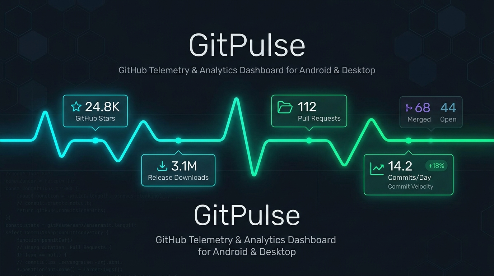
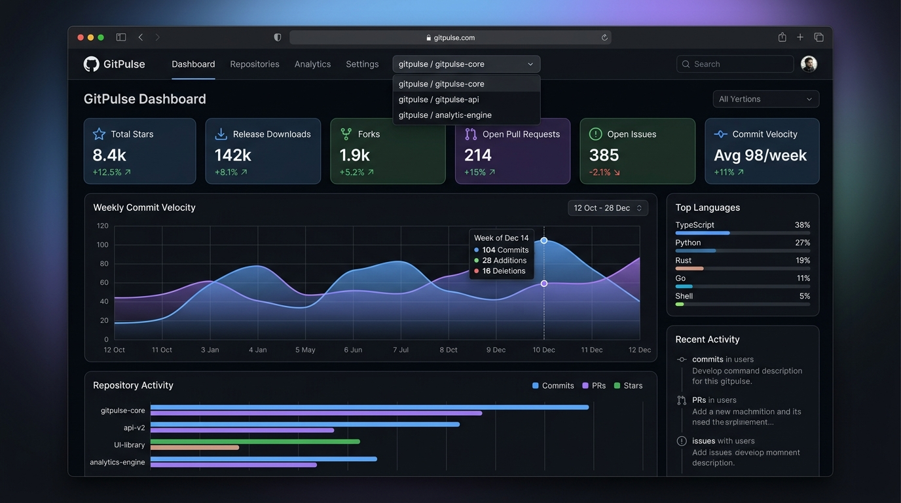
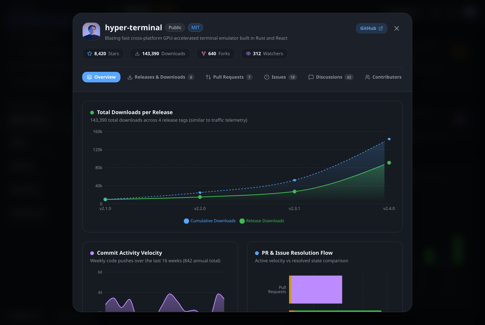
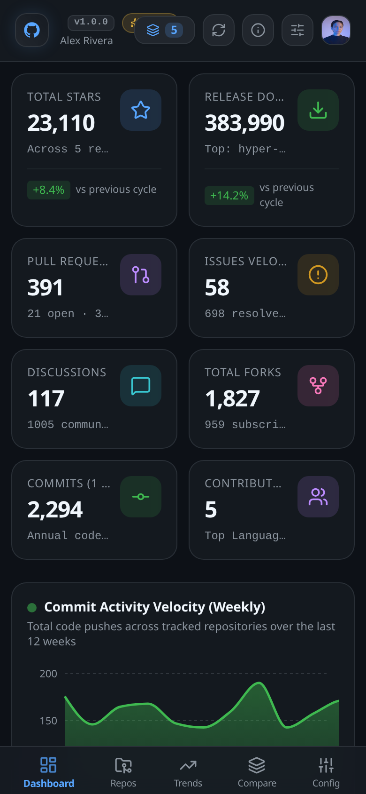
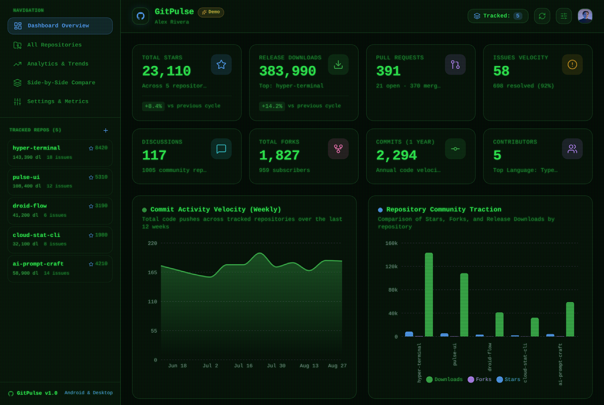

# GitPulse

<div align="center">



**A high-performance, cross-platform GitHub analytics and telemetry dashboard.**  
*Engineered for Android (smartphones, foldables, tablets), Native Linux Desktop, Windows, and Web.*

[](https://reactjs.org/)
[](https://www.typescriptlang.org/)
[](https://vitejs.dev/)
[](https://tailwindcss.com/)
[](https://capacitorjs.com/)
[](https://tauri.app/)
[](LICENSE)

[Features](#features) • [Screenshots](#screenshots) • [Architecture](#architecture) • [Getting Started](#getting-started) • [Android Build](#building-for-android) • [Linux Desktop Build](#building-for-linux-desktop) • [License](#license)

</div>

---

## Overview

**GitPulse** is a lightweight, responsive GitHub statistics and development velocity tracker designed to give developers, maintainers, and engineering teams instant clarity over their public and private repositories.

GitPulse is built specifically for **multi-device ergonomics**:
* **Smartphones**: Single-thumb bottom navigation, touch-optimized swipeable cards, and full safe-area notch support.
* **Foldables & Flip Phones**: Dynamically transitions when folding or unfolding (e.g. Samsung Galaxy Z Fold, Google Pixel Fold) between compact and expanded navigation rail layouts without reloading state.
* **Tablets & Desktop**: Persistent sidebar, multi-column analytics grid, and side-by-side comparison views.

---

## Screenshots

<div align="center">

### Main Analytics Dashboard (GitHub Dark)


### Repository Deep-Dive & Release Downloads Telemetry


<table>
  <tr>
    <td width="40%" align="center">
      <strong>Mobile Phone Viewport</strong><br/><br/>
      
    </td>
    <td width="60%" align="center">
      <strong>Retro CRT Terminal Mode</strong><br/><br/>
      
    </td>
  </tr>
</table>

</div>

---

## Features

### Telemetry & Analytics
* **Community Traction**: Track Stars, Watchers, and Network Forks across multiple repositories in real-time.
* **Release & Binary Downloads**: Aggregates asset download counts across every published release tag (`.AppImage`, `.deb`, `.exe`, `.dmg`, `.aar`, `.whl`).
* **Pull Request Resolution Funnel**: Monitor Open vs. Merged vs. Closed PR velocity and merge turnaround times.
* **Issue Health & Backlog Velocity**: Real-time open backlog vs. resolved issue ratios.
* **Discussions & Comments**: Full GraphQL v4 integration to monitor discussion threads, community comments, and topic upvotes.
* **Annual Commit Velocity**: 52-week activity charts tracking weekly push frequency and code momentum.
* **Traffic Views & Unique Visitors**: 14-day history of repository page visits and unique visitor telemetry.
* **Language Composition**: Multi-language byte-ratio breakdowns and primary language classifiers.

### Repository Deep-Dive Modal
* **Interactive Filtering**: Filter Pull Requests (`All`, `Open`, `Merged`) and Issues (`All`, `Open`, `Closed`).
* **Unfoldable Comment Threads**: Click any Issue, PR, or Discussion to unfold full descriptions and inspect threaded review comments, author avatars, and timestamps.
* **Unicode Emoji Parsing**: Automatic translation of GitHub shortcodes (e.g. `:bulb:`, `:raised_hands:`, `:tada:`) into native rendered emojis.
* **Release Download Curves**: Smooth dual-curve telemetry plots comparing tag downloads against cumulative download trajectories.

### Dynamic Multi-Theme Engine
Switch between 6 distinct palettes tailored for any environment:
1. **GitHub Dark**: Classic GitHub slate-dark theme (`#0d1117`).
2. **OLED Pure Black**: Maximum battery savings on OLED and AMOLED phone screens (`#000000`).
3. **Retro CRT Terminal**: Vintage 80s phosphor bright green (`#33ff57`) on deep CRT black (`#050d08`) with realistic animated scanlines and phosphor glow.
4. **Dracula**: High-contrast dark theme with neon cyan, green, and pink accents (`#282a36`).
5. **Nord Blue**: Arctic slate palette with cool frost accents (`#181c24`).
6. **Light Mode**: Clean daytime palette with high-contrast text (`#f6f8fa`).

---

## Adaptive Layout Matrix

| Form Factor | Screen Width | Layout Strategy |
| :--- | :--- | :--- |
| **Compact** | `< 600px` (Phone Portrait) | Header + 2-Column KPI Grid + Stacked Charts + Fixed Bottom Nav Bar (`safe-area-inset` padded) |
| **Medium** | `600px - 840px` (Foldable Unfolded / Flip Phone) | Left-aligned Compact **Navigation Rail** + 2–3 Column Adaptive Grid + Side-by-Side Charts |
| **Expanded** | `> 840px` (Tablet Landscape & Desktop) | Persistent **Sidebar** + Master-Detail View + Multi-column analytics grid |

---

## Architecture

```text
┌────────────────────────────────────────────────────────┐
│                   GitPulse UI Layer                    │
│    (React 19 + TypeScript + Tailwind CSS + Recharts)   │
└──────────────┬──────────────────────────┬──────────────┘
               │                          │
   ┌───────────▼───────────┐  ┌───────────▼───────────┐
   │      Capacitor 6      │  │       Tauri 2.0       │
   │    Android Runtime    │  │  Rust Native Desktop  │
   │ (APK / AAB / Foldable)│  │ (Linux .deb / AppImage│
   │                       │  │  Windows .msi / .exe) │
   └───────────┬───────────┘  └───────────┬───────────┘
               │                          │
               └───────────┬──────────────┘
                           │
             ┌─────────────▼─────────────┐
             │    GitHub API Service     │
             │  REST API v3 + GraphQL v4 │
             │  Local Caching + Offline  │
             └───────────────────────────┘
```

* **Frontend**: React 19, TypeScript, Vite
* **Styling**: Tailwind CSS with space-separated dynamic CSS variable channels
* **Data Visualization**: Recharts (Responsive Area, Line, Bar, and Pie components)
* **Mobile Runtime**: Capacitor 6 (Edge-to-edge Android display, Safe Area insets)
* **Desktop Runtime**: Tauri 2.0 (Rust + WebKitGTK / WebView2)
* **API Integration**: REST v3 + GitHub GraphQL v4 with offline LocalStorage caching and 1-click Demo Mode

---

## Getting Started

### Prerequisites
* Node.js (v18+ or v20+)
* npm or pnpm

### Installation

1. **Clone the repository:**
   ```bash
   git clone https://github.com/your-username/git-pulse.git
   cd git-pulse
   ```

2. **Install dependencies:**
   ```bash
   npm install
   ```

3. **Start local web development server:**
   ```bash
   npm run dev
   ```
   Open [http://localhost:3000](http://localhost:3000) in your browser.

---

## Building for Android

GitPulse is packaged for Android via Capacitor 6.

### 1. Requirements
* Android Studio installed (or Android SDK command-line tools).
* Android device connected via USB with **USB Debugging** enabled (or an active Android Emulator).

### 2. Build & Deploy Directly to USB Phone
```bash
# Compile web assets + sync with Android project + deploy to device
npx cap run android
```

### 3. Manual Gradle Build (CLI)
```bash
# 1. Compile web bundle
npm run build

# 2. Sync assets with native Android assets
npx cap sync android

# 3. Build debug APK
cd android
./gradlew assembleDebug

# Output APK located at:
# android/app/build/outputs/apk/debug/app-debug.apk
```

---

## Building for Linux Desktop

GitPulse includes a native Tauri 2.0 desktop runner.

### 1. Requirements (Debian / Ubuntu / Pop!_OS)
```bash
sudo apt update
sudo apt install -y \
  libwebkit2gtk-4.1-dev \
  build-essential \
  curl \
  wget \
  file \
  libxdo-dev \
  libssl-dev \
  libayatana-appindicator3-dev \
  librsvg2-dev
```

### 2. Run Desktop in Live Dev Mode
```bash
npm run desktop:dev
```

### 3. Build Native Linux Binary, `.AppImage`, & `.deb`
```bash
npm run desktop:build
```
Generated release outputs:
* **Standalone Executable**: `src-tauri/target/release/git-pulse`
* **Portable AppImage**: `src-tauri/target/release/bundle/appimage/git-pulse_0.1.0_amd64.AppImage`
* **Debian Package**: `src-tauri/target/release/bundle/deb/git-pulse_0.1.0_amd64.deb`

---

## Building for Windows

Run the build script on a Windows machine:
```powershell
npm run desktop:build
```
Outputs `.msi` installers and `.exe` binaries in `src-tauri/target/release/bundle/msi/`.

---

## Configuration & Environment

### GitHub Authentication & Instances
* **Standard GitHub (github.com)**: Connect using a classic or fine-grained token with `repo` (or `public_repo`) and `read:discussion` scopes.
* **GitHub Enterprise Server (GHES)**: Point GitPulse directly to your self-hosted company server (e.g. `https://github.mycompany.com`). REST endpoints (`/api/v3`) and GraphQL endpoints (`/api/graphql`) are automatically derived.
* **Demo Mode**: 1-click instant sandbox with 5 pre-loaded realistic repositories (`hyper-terminal`, `pulse-ui`, `droid-flow`, `cloud-stat-cli`, `ai-prompt-craft`).

### Customizable Settings
* **Metrics Visibility**: Selectively toggle any KPI card on/off from the settings modal.
* **Server Instance Switching**: Switch between GitHub.com and Enterprise instances at any time without reinstalling.
* **Auto-Refresh**: Set automatic background refresh frequency (`Off`, `15m`, `1h`, `6h`, `24h`).
* **Cache Management**: One-click cache flushing and instant re-fetching.

---

## Contributing

Contributions are welcome. Please ensure that all pull requests follow the **Conventional Commits** format (`feat:`, `fix:`, `chore:`, `docs:`, `style:`).

1. Fork the Project
2. Create your Feature Branch (`git checkout -b feat/amazing-feature`)
3. Commit your Changes (`git commit -m 'feat: add amazing new metric'`)
4. Push to the Branch (`git push origin feat/amazing-feature`)
5. Open a Pull Request

---

## License

Distributed under the **MIT License**. See `LICENSE` for more information.
